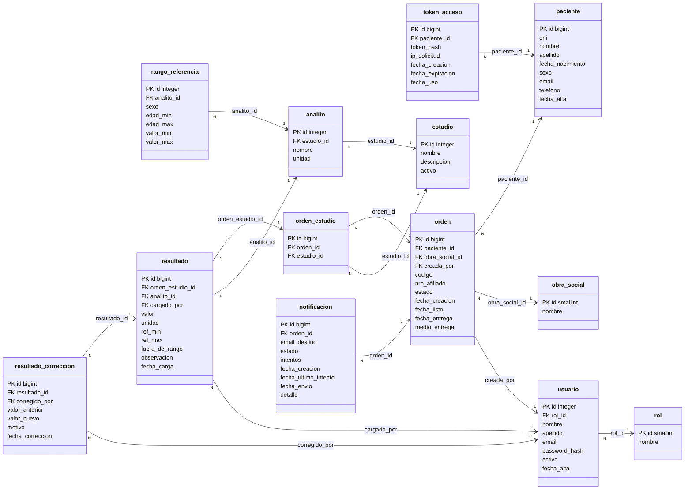

# Diagrama Entidad-Relación

Esquema relacional de **LabResultados** (PostgreSQL). El script que lo crea está en [`01_schema.sql`](01_schema.sql).

## Cómo leer el diagrama

- Cada caja es una **tabla**: `PK` es la clave primaria (con su tipo) y `FK` las claves foráneas.
- Cada **flecha** es una relación **N:1 (muchos a uno)**. Sale de la tabla que tiene la clave foránea (**N**) y apunta a la tabla referenciada (**1**).
- El texto sobre la flecha es la columna que las une.

Ejemplo: `orden "N" → "1" paciente` se lee *"muchas órdenes pertenecen a un paciente"* (o al revés: *"un paciente tiene muchas órdenes"*).

> Versión en imagen: [`docs/images/diagrama-er.png`](../docs/images/diagrama-er.png)

## Relaciones

| Desde (N) | Hacia (1) | Clave foránea | Se lee |
| --- | --- | --- | --- |
| usuario | rol | `rol_id` | Cada usuario tiene un único rol; un rol lo pueden tener muchos usuarios |
| token_acceso | paciente | `paciente_id` | Un paciente puede pedir varios enlaces de acceso al portal |
| orden | paciente | `paciente_id` | Un paciente puede tener muchas órdenes |
| orden | obra_social | `obra_social_id` | Cada orden registra la cobertura presentada en esa visita |
| orden | usuario | `creada_por` | Cada orden la registra un usuario de recepción |
| orden_estudio | orden | `orden_id` | Una orden incluye uno o más estudios |
| orden_estudio | estudio | `estudio_id` | Un estudio puede pedirse en muchas órdenes |
| analito | estudio | `estudio_id` | Un estudio se compone de uno o más analitos |
| rango_referencia | analito | `analito_id` | Un analito puede tener varios rangos (por sexo/edad) |
| resultado | orden_estudio | `orden_estudio_id` | Cada resultado corresponde a un estudio pedido en una orden |
| resultado | analito | `analito_id` | Cada resultado mide un analito |
| resultado | usuario | `cargado_por` | Cada resultado lo carga un bioquímico |
| resultado_correccion | resultado | `resultado_id` | Un resultado puede corregirse varias veces; cada corrección queda registrada |
| resultado_correccion | usuario | `corregido_por` | Cada corrección la hace un bioquímico |
| notificacion | orden | `orden_id` | Una orden puede tener uno o más avisos |

### Relación N:M entre orden y estudio

Una orden puede incluir **muchos** estudios y un mismo estudio se pide en **muchas** órdenes. Esa relación muchos a muchos se resuelve con la tabla intermedia **`orden_estudio`**, que la descompone en dos relaciones N:1.

## Tablas por módulo

Cada tabla la administra uno de los módulos definidos en [`docs/modulos.md`](../docs/modulos.md):

| Módulo | Tablas |
| --- | --- |
| Gestión de usuarios y acceso | `rol`, `usuario`, `token_acceso` |
| Gestión de pacientes | `paciente` |
| Administración de estudios | `estudio`, `analito`, `rango_referencia` |
| Gestión de órdenes | `orden`, `orden_estudio`, `obra_social` |
| Gestión de resultados | `resultado`, `resultado_correccion` |
| Consulta e Historial de resultados | `vista_historial_resultados` (solo lectura) |
| Notificaciones | `notificacion` |

## Tamaño de los identificadores

El tipo de cada `id` depende de cuántos registros va a tener la tabla:

| Tipo | Rango | Tablas | Por qué |
| --- | --- | --- | --- |
| `SMALLINT` | hasta 32.767 | `rol`, `obra_social` | Catálogos chicos: hay 3 roles y unas pocas cientos de obras sociales y prepagas en el país |
| `INTEGER` | hasta ~2.100 millones | `usuario`, `estudio`, `analito`, `rango_referencia` | Crecen poco: el personal y el catálogo de estudios de un laboratorio |
| `BIGINT` | sin límite práctico | `paciente`, `orden`, `orden_estudio`, `resultado`, `resultado_correccion`, `notificacion`, `token_acceso` | Crecen todos los días con la atención del laboratorio |

Cada clave foránea usa exactamente el mismo tipo que la clave que referencia.

## Decisiones de diseño

- **El resultado guarda una copia de la unidad y del rango aplicado** (`unidad`, `ref_min`, `ref_max`). Así un resultado viejo se sigue interpretando igual aunque después cambie la configuración del estudio (regla del módulo *Historial de resultados*).
- **`fuera_de_rango` lo calcula la base de datos** (columna generada): no depende de que el código se acuerde de marcarlo.
- **Rangos por sexo y edad**: un analito puede tener varios rangos (ej.: la hemoglobina normal es distinta en hombres y mujeres). Por eso el paciente tiene `sexo` y `fecha_nacimiento`.
- **La obra social se registra solo en la orden** (junto con el número de afiliado). El paciente presenta su credencial en cada visita, así que la cobertura que importa es la de ese día. Guardarla también en el paciente sería un dato que se desactualiza y que la Ley 25.326 pide no almacenar si no es necesario (minimización de datos). Para no volver a tipearla, la recepción puede precargar la cobertura de la última orden del paciente.
- **Las correcciones de resultados quedan auditadas** en `resultado_correccion`: valor anterior, valor nuevo, motivo obligatorio, quién y cuándo. Al ser un dato clínico, el valor original nunca se pierde.
- **El estado de la orden es coherente con sus fechas**: la base exige `fecha_listo` cuando la orden deja de estar `EN_PROCESO`, y `fecha_entrega` + `medio_entrega` cuando pasa a `ENTREGADO`. El medio es `PORTAL` (el sistema la marca sola cuando el paciente ve sus resultados online) o `MOSTRADOR` (la marca la recepción).
- **Las notificaciones se reintentan**: el aviso se crea `PENDIENTE` y lo envía una tarea programada; si falla, se reintenta hasta 3 veces (`intentos`) y, si los agota, queda `FALLIDA` para que la recepción avise por otro medio.
- **Acceso del paciente con enlace temporal**: el paciente pide acceso con su DNI y el código de su orden, y recibe por email un enlace con un token de un solo uso que vence a los 15 minutos. En `token_acceso` se guarda solo el hash SHA-256 del token. Ver [Arquitectura](../docs/arquitectura.md) y *Protección de datos y marco legal* en la propuesta.
- **Una orden con resultados no se puede borrar**, y tampoco un resultado que tiene correcciones: la base lo impide para no perder información clínica.
- **La vista de historial solo muestra órdenes `LISTO` o `ENTREGADO`**: una orden en proceso no le muestra resultados al paciente.
