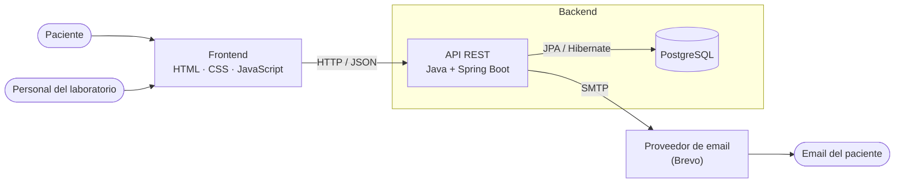
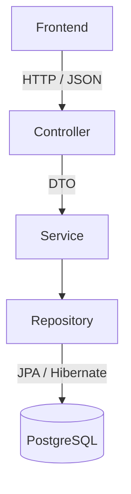
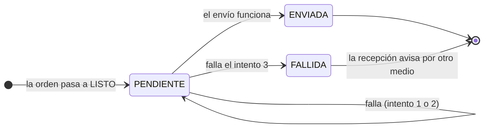
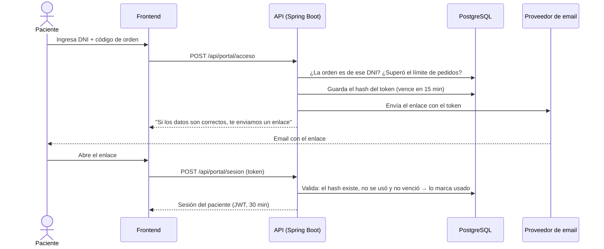

# Arquitectura del sistema

## 1. Arquitectura macro

El sistema se divide en dos grandes componentes que se comunican por HTTP:

- **Frontend**: la interfaz web (HTML, CSS y JavaScript) que usan el personal del laboratorio y los pacientes.
- **Backend**: una **API REST** en Java + Spring Boot, junto con la **base de datos** PostgreSQL donde se guarda la información.



En desarrollo, el backend y la base se levantan con Docker Compose. Para el MVP en la nube: frontend estático (Vercel o Netlify), backend en Render y base de datos en Supabase.

## 2. Estilo arquitectónico: monolito modular en capas

**Elegimos un monolito modular organizado en capas.**

- **Monolito**: todo el backend es una sola aplicación Spring Boot que se despliega como una unidad.
- **Modular**: por dentro, el código se divide en un paquete por cada módulo del [listado de módulos](modulos.md). Cada módulo tiene límites claros y es dueño de sus tablas.
- **En capas**: dentro de cada módulo, el código se separa en capas con responsabilidades distintas (controlador, servicio y repositorio).

### ¿Por qué este estilo?

| Alternativa | ¿La elegimos? | Motivo |
| --- | --- | --- |
| Monolito modular en capas | ✅ Sí | Simple de desplegar y mantener para un equipo de dos. Los módulos permiten repartir el trabajo y mantener el código ordenado. |
| Microservicios | ❌ No | Sobreingeniería para un laboratorio chico: varios despliegues, comunicación en red entre servicios y más infraestructura, sin un beneficio real a esta escala. |
| MVC clásico con vistas en el servidor (ej.: Thymeleaf) | ❌ No | El frontend es independiente y consume la API REST. Igual conservamos la idea de MVC: el *modelo* son las entidades y la lógica de negocio. El *controlador* es el controller REST y la *vista* es el frontend. |
| Arquitectura hexagonal / clean | ❌ No | Suma capas de abstracción y una curva de aprendizaje que el MVP no necesita. |

Además, es el enfoque que vimos en la cursada (Spring Boot, JPA, DTOs y APIs REST en Programación III), en línea con el criterio de elegir lo que el equipo ya domina.

Si en el futuro un módulo creciera mucho (por ejemplo, Notificaciones), el diseño modular permitiría separarlo sin reescribir el resto.

## 3. Organización del backend

### Capas



| Capa | Responsabilidad | Ejemplo |
| --- | --- | --- |
| **Controller** | Recibe la petición HTTP, valida los datos de entrada y devuelve la respuesta en JSON. No contiene reglas de negocio. | `OrdenController` expone `POST /api/ordenes` |
| **Service** | Contiene las **reglas de negocio** y coordina con otros módulos. | `ResultadoService` elige el rango de referencia según el sexo y la edad del paciente y, al completar la carga, pasa la orden a `LISTO` |
| **Repository** | Accede a la base de datos con Spring Data JPA. | `OrdenRepository.findByCodigo(...)` |

### Objetos que viajan entre las capas

Las entidades y los DTO **no son capas**: son los objetos que las capas se pasan entre sí.

| Objeto | Qué es | Entre qué capas viaja | Ejemplo |
| --- | --- | --- | --- |
| **Entity** | Clase que representa una tabla de la base (mapeo JPA). | Repository ↔ Service | `Orden`, `Resultado` |
| **DTO** | Objeto con los datos que entran o salen por la API. Evita exponer las entidades: por ejemplo, nunca se envía el `password_hash`. | Frontend ↔ Controller ↔ Service | `OrdenRequest`, `ResultadoResponse` |

El servicio es quien convierte entre unos y otros: recibe un DTO del controller, trabaja con entidades y devuelve un DTO.

### Paquetes: uno por módulo

```
backend/src/main/java/ar/edu/utn/labresultados/
├── LabResultadosApplication.java
├── usuarios/          → Gestión de usuarios y acceso
│   ├── UsuarioController.java
│   ├── UsuarioService.java
│   ├── UsuarioRepository.java
│   ├── Usuario.java
│   ├── Rol.java
│   └── dto/
├── pacientes/         → Gestión de pacientes
├── estudios/          → Administración de estudios (estudio, analito, rango)
├── ordenes/           → Gestión de órdenes
├── resultados/        → Gestión de resultados
├── consulta/          → Consulta de resultados (portal del paciente)
├── historial/         → Historial de resultados
├── notificaciones/    → Notificaciones por email
└── comun/             → Configuración, seguridad y manejo de errores
```

Cada paquete repite la misma estructura interna que `usuarios/` (controller, service, repository, entidades y DTOs).

### Reglas de convivencia entre módulos

- Un módulo **no accede a los repositorios de otro**: si necesita algo, llama a su **servicio**. Ej.: `ResultadoService` le pide a `OrdenService` que cambie el estado de la orden.
- Cuando una orden pasa a `LISTO`, el módulo de órdenes le pide a `NotificacionService` que **registre** el aviso. El envío se hace después y por separado (ver *Notificaciones*).
- Lo transversal (seguridad, errores, configuración) vive en `comun/`.

### Notificaciones: envío asíncrono con reintentos

El envío del email **no es síncrono**: pasar una orden a `LISTO` no espera a que el email salga. Si el proveedor de email está lento o caído, la orden igual queda `LISTO` y no se pierde el aviso.

1. Al pasar la orden a `LISTO`, en la misma transacción se crea el aviso en la tabla `notificacion`, en estado `PENDIENTE`.
2. Una **tarea programada** del backend (`@Scheduled`, cada 5 minutos) toma los avisos `PENDIENTE` y los envía.
3. Si el envío funciona, el aviso pasa a `ENVIADA`. Si falla, la tarea suma un intento, guarda el error y lo deja `PENDIENTE` para reintentarlo más tarde: espera 5 minutos antes del 2.º intento y 10 antes del 3.º.
4. Si falla el 3.er intento, pasa a `FALLIDA` y aparece en el panel de la recepción, que avisa al paciente por otro medio (por ejemplo, por teléfono).



**Quién reintenta y cuándo:** lo hace el propio sistema, con la tarea programada, sin intervención de nadie. Una persona solo interviene cuando se agotan los intentos.

Los **enlaces de acceso** del paciente (ver 4.2) son la excepción: se envían en el momento, porque el paciente los está esperando. Si ese envío falla, el paciente puede volver a pedirlo.

### Proveedor de email: dependencia externa

Sí, el sistema depende de un servicio externo para enviar emails: los avisos de resultados y los enlaces de acceso del paciente.

- **Proveedor elegido:** [Brevo](https://www.brevo.com/) (ex Sendinblue), conectado por **SMTP** con Spring Boot Mail (`spring-boot-starter-mail`). No usamos librerías propias del proveedor.
- **Límite del plan gratuito:** alrededor de 300 emails por día (valor vigente al momento de esta revisión; se verifica al configurar la cuenta).
- **Volumen estimado:** con 20 a 25 pacientes por día, son unos 25 avisos de resultados más 25 a 50 enlaces de acceso: **hasta 75 emails diarios**, alrededor de un 25 % del límite.
- **Alternativa:** Resend, que también tiene plan gratuito pero con un límite diario menor.

| Riesgo | Mitigación |
| --- | --- |
| El proveedor está caído o se alcanzó el límite del día | Los avisos quedan `PENDIENTE` y se reintentan; si se agotan los intentos, la recepción avisa por otro medio. |
| El paciente no recibe su enlace de acceso | Puede volver a pedirlo más tarde o retirar los resultados en el mostrador. |
| Hay que cambiar de proveedor (precio, límites, calidad) | Al usar SMTP estándar, alcanza con cambiar el servidor, el usuario y la clave en la configuración, sin tocar el código. |
| Se filtran las credenciales SMTP | Se guardan como variables de entorno del servidor, nunca en el repositorio. |

En desarrollo se usa **Mailpit** dentro de Docker Compose: captura los emails localmente para probarlos sin enviarlos de verdad.

## 4. Seguridad: autenticación y autorización

- **Autenticación**: comprobar *quién es* el usuario (inicio de sesión del personal o enlace del paciente).
- **Autorización**: decidir *qué puede hacer* según su rol y, en el caso del paciente, sobre qué datos (solo los propios).

Ambas se implementan con **Spring Security**.

### 4.1 Personal del laboratorio

- Inicia sesión con **email y contraseña**. La contraseña se guarda como hash BCrypt, nunca en texto plano.
- Si los datos son correctos, el backend entrega un **token JWT firmado** con el id y el rol del usuario, que vence a las **8 horas** (una jornada). El frontend lo envía en cada pedido, en el encabezado `Authorization`.
- Elegimos JWT en lugar de una sesión con cookie porque el frontend y el backend se despliegan en dominios distintos (Vercel y Render), donde las cookies entre sitios complican la configuración.
- Un usuario dado de baja (`activo = false`) no puede iniciar sesión.

### 4.2 Paciente: enlace de acceso temporal por email

El paciente no tiene usuario ni contraseña. Para entrar al portal **pide un enlace** con su DNI y el código de su orden (figura en el comprobante que le da la recepción), y el sistema se lo envía **al email que tiene registrado**:



El token es un valor aleatorio de 256 bits. En la base se guarda **solo su hash** (tabla `token_acceso`), así que aunque alguien leyera la tabla no podría usar los enlaces.

**Protecciones contra el acceso indebido y la fuerza bruta:**

| Riesgo | Protección |
| --- | --- |
| Alguien adivina o conoce el DNI y el código de una orden | Con eso solo puede *pedir* un enlace, que llega al **email del paciente**: hace falta tener acceso a ese correo para entrar. |
| Probar códigos o tokens al azar (fuerza bruta) | El token tiene 256 bits: es imposible de adivinar. Además se limita la cantidad de pedidos: máximo 3 enlaces por paciente cada 15 minutos, y un tope por IP. |
| Un enlace viejo que queda en la bandeja de entrada | El token es de **un solo uso** y **vence a los 15 minutos**. No persiste: la sesión que genera dura 30 minutos y después hay que pedir otro enlace. |
| Averiguar qué DNI son pacientes del laboratorio | El sistema responde siempre el mismo mensaje genérico (*"si los datos son correctos, te enviamos un enlace"*), exista o no el paciente. |
| Interceptar el enlace o la sesión | Todo el tráfico va por HTTPS. |

Requisito: el paciente tiene que tener un email registrado. Si no tiene, retira sus resultados en el mostrador.

### 4.3 Qué ve el paciente con su sesión

**Decisión:** una vez que entra, el paciente ve **todas sus órdenes y su historial completo**, no solo la orden con la que pidió el enlace.

**Justificación:** el código de orden ya no es la llave de acceso; solo sirve para *pedir* el enlace. Lo que identifica al paciente es haber abierto el enlace que llegó a **su propio email**, por eso la sesión representa al paciente y no a una orden. Ver el historial completo es lo que permite comparar con resultados anteriores, que es parte central de la propuesta.

El paciente nunca puede ver datos de otro: el backend toma su `paciente_id` de la sesión y filtra todas las consultas por él. No usa identificadores que mande el frontend.

### 4.4 Autorización por roles (RBAC)

Cada endpoint de la API tiene definidos los roles que pueden usarlo. Se aplica el principio de **mínimo privilegio**: cada rol accede solo a lo que necesita para su tarea. Además del rol, el paciente solo accede a **sus propios datos** (ver 4.3).

| Endpoint | Descripción | Roles con acceso | Justificación |
| --- | --- | --- | --- |
| `POST /api/auth/login` | Inicio de sesión del personal | Público | Es la puerta de entrada; devuelve el JWT. |
| `PUT /api/usuarios/me/password` | Cambiar la propia contraseña | Administrador, Recepción, Bioquímico | Cada usuario administra su propia credencial. |
| `GET /api/usuarios` | Listar el personal | Administrador | Solo el administrador gestiona usuarios. |
| `POST /api/usuarios` | Alta de un usuario y asignación de rol | Administrador | Evita que alguien se otorgue permisos a sí mismo. |
| `PUT /api/usuarios/{id}` | Modificar datos, rol o dar de baja | Administrador | Ídem anterior. |
| `POST /api/portal/acceso` | Pedir el enlace de acceso (DNI + código de orden) | Público | Responde siempre el mismo mensaje y limita la cantidad de pedidos. |
| `POST /api/portal/sesion` | Canjear el token del enlace por una sesión | Público, con token válido | El token de un solo uso es la prueba de identidad del paciente. |
| `GET /api/pacientes?dni=` | Buscar un paciente | Recepción, Bioquímico | Recepción lo necesita para registrar órdenes; el bioquímico, para conocer sexo y edad al interpretar. |
| `POST /api/pacientes` | Alta de un paciente | Recepción | Los datos personales los carga quien atiende en el mostrador. |
| `PUT /api/pacientes/{id}` | Modificar los datos de un paciente | Recepción | Ídem anterior. |
| `GET /api/estudios` | Ver estudios, analitos y rangos de referencia | Administrador, Recepción, Bioquímico | Recepción elige los estudios de la orden; el bioquímico consulta los rangos. |
| `POST /api/estudios`, `PUT /api/estudios/{id}` | Configurar estudios, analitos y rangos | Administrador | Un cambio de rango afecta cómo se interpretan los resultados. |
| `POST /api/ordenes` | Registrar una orden | Recepción | Es una tarea del mostrador. |
| `GET /api/ordenes?estado=` | Listar órdenes por estado | Recepción, Bioquímico | Recepción sigue el estado; el bioquímico ve las pendientes de carga. |
| `PATCH /api/ordenes/{id}/entrega` | Marcar como entregada en el mostrador | Recepción | Quien entrega en persona deja el registro (medio `MOSTRADOR`). |
| `POST /api/ordenes/{id}/resultados` | Cargar los resultados de una orden | Bioquímico | Solo un profesional carga datos clínicos. |
| `PUT /api/resultados/{id}` | Corregir un resultado (con motivo) | Bioquímico | Ídem anterior; la corrección queda auditada. |
| `PATCH /api/ordenes/{id}/listo` | Cerrar la carga y pasar la orden a `LISTO` | Bioquímico | Es quien libera los resultados para el paciente. |
| `GET /api/notificaciones?estado=FALLIDA` | Ver los avisos que no se pudieron enviar | Recepción | Para avisar al paciente por otro medio. |
| `GET /api/portal/ordenes` | Ver sus órdenes, estados y resultados | Paciente (solo las propias) | Se filtra por el paciente de la sesión. |
| `GET /api/portal/historial?analito=` | Ver la evolución de un analito | Paciente (solo el propio) | Ídem anterior. |

Si alguien llama a un endpoint sin sesión, la API responde `401 No autenticado`; si tiene sesión pero no el rol necesario, `403 Prohibido`.

## 5. Organización del frontend

Frontend en HTML, CSS y JavaScript, sin framework, organizado **por pantallas según el actor** que las usa. Toda la comunicación con el backend pasa por un único archivo (`api.js`).

```
frontend/
├── index.html              → el paciente pide su enlace de acceso (DNI + código de orden)
├── paciente/
│   ├── acceso.html         → abre el enlace del email y crea la sesión
│   ├── ordenes.html        → sus órdenes, estado y resultados
│   └── historial.html      → resultados anteriores y evolución
├── personal/
│   ├── login.html
│   ├── recepcion/          → pacientes y órdenes
│   ├── bioquimico/         → carga de resultados
│   └── admin/              → usuarios y estudios
├── js/
│   ├── api.js              → único punto de llamadas a la API REST (fetch)
│   ├── auth.js             → sesión del personal y del paciente
│   └── ...                 → un archivo por pantalla
└── css/
```

## 6. Resumen: de cada módulo a su código y sus tablas

| Módulo | Paquete backend | Pantallas frontend | Tablas |
| --- | --- | --- | --- |
| Gestión de usuarios y acceso | `usuarios` | `index.html`, `paciente/acceso.html`, `personal/login.html`, `personal/admin` | `usuario`, `rol`, `token_acceso` |
| Gestión de pacientes | `pacientes` | `personal/recepcion` | `paciente`, `obra_social` |
| Gestión de órdenes | `ordenes` | `personal/recepcion` | `orden`, `orden_estudio` |
| Gestión de resultados | `resultados` | `personal/bioquimico` | `resultado` |
| Consulta de resultados | `consulta` | `paciente/ordenes.html` | `vista_historial_resultados` |
| Historial de resultados | `historial` | `paciente/historial.html` | `vista_historial_resultados` |
| Notificaciones | `notificaciones` | — (lo dispara el sistema) | `notificacion` |
| Administración de estudios | `estudios` | `personal/admin` | `estudio`, `analito`, `rango_referencia` |

El detalle de cada tabla y sus relaciones está en el [diagrama entidad-relación](../database/diagrama-er.md).
