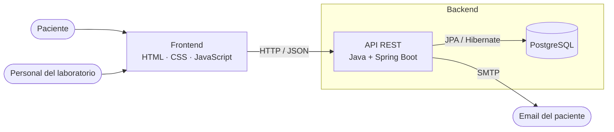
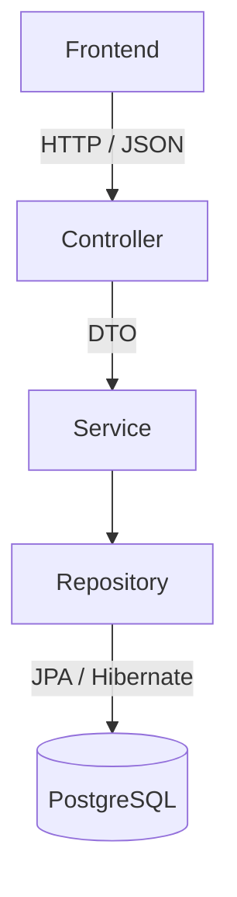
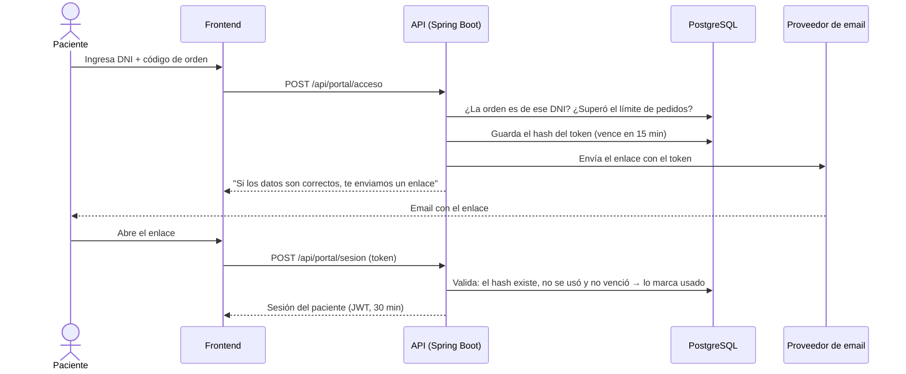

# Arquitectura del sistema

## 1. Arquitectura macro

El sistema se divide en dos grandes componentes que se comunican por HTTP:

- **Frontend**: la interfaz web (HTML, CSS y JavaScript) que usan el personal del laboratorio y los pacientes.
- **Backend**: una **API REST** en Java + Spring Boot, junto con la **base de datos** PostgreSQL donde se guarda la información.



En desarrollo, el backend y la base se levantan con Docker Compose. Para el MVP en la nube: frontend estático (Vercel o Netlify), backend en Render y base de datos en Supabase.

## 2. Estilo arquitectónico: monolito modular en capas

**Elegimos un monolito modular organizado en capas.**

- **Monolito**: todo el backend es una sola aplicación Spring Boot que se despliega como una unidad.
- **Modular**: por dentro, el código se divide en un paquete por cada módulo del [listado de módulos](modulos.md). Cada módulo tiene límites claros y es dueño de sus tablas.
- **En capas**: dentro de cada módulo, el código se separa en capas con responsabilidades distintas (controlador, servicio y repositorio).

### ¿Por qué este estilo?

| Alternativa | ¿La elegimos? | Motivo |
| --- | --- | --- |
| Monolito modular en capas | ✅ Sí | Simple de desplegar y mantener para un equipo de dos. Los módulos permiten repartir el trabajo y mantener el código ordenado. |
| Microservicios | ❌ No | Sobreingeniería para un laboratorio chico: varios despliegues, comunicación en red entre servicios y más infraestructura, sin un beneficio real a esta escala. |
| MVC clásico con vistas en el servidor (ej.: Thymeleaf) | ❌ No | El frontend es independiente y consume la API REST. Igual conservamos la idea de MVC: el *modelo* son las entidades y la lógica de negocio. El *controlador* es el controller REST y la *vista* es el frontend. |
| Arquitectura hexagonal / clean | ❌ No | Suma capas de abstracción y una curva de aprendizaje que el MVP no necesita. |

Además, es el enfoque que vimos en la cursada (Spring Boot, JPA, DTOs y APIs REST en Programación III), en línea con el criterio de elegir lo que el equipo ya domina.

Si en el futuro un módulo creciera mucho (por ejemplo, Notificaciones), el diseño modular permitiría separarlo sin reescribir el resto.

## 3. Organización del backend

### Capas



| Capa | Responsabilidad | Ejemplo |
| --- | --- | --- |
| **Controller** | Recibe la petición HTTP, valida los datos de entrada y devuelve la respuesta en JSON. No contiene reglas de negocio. | `OrdenController` expone `POST /api/ordenes` |
| **Service** | Contiene las **reglas de negocio** y coordina con otros módulos. | `ResultadoService` elige el rango de referencia según el sexo y la edad del paciente y, al completar la carga, pasa la orden a `LISTO` |
| **Repository** | Accede a la base de datos con Spring Data JPA. | `OrdenRepository.findByCodigo(...)` |

### Objetos que viajan entre las capas

Las entidades y los DTO **no son capas**: son los objetos que las capas se pasan entre sí.

| Objeto | Qué es | Entre qué capas viaja | Ejemplo |
| --- | --- | --- | --- |
| **Entity** | Clase que representa una tabla de la base (mapeo JPA). | Repository ↔ Service | `Orden`, `Resultado` |
| **DTO** | Objeto con los datos que entran o salen por la API. Evita exponer las entidades: por ejemplo, nunca se envía el `password_hash`. | Frontend ↔ Controller ↔ Service | `OrdenRequest`, `ResultadoResponse` |

El servicio es quien convierte entre unos y otros: recibe un DTO del controller, trabaja con entidades y devuelve un DTO.

### Paquetes: uno por módulo

```
backend/src/main/java/ar/edu/utn/labresultados/
├── LabResultadosApplication.java
├── usuarios/          → Gestión de usuarios y roles
│   ├── UsuarioController.java
│   ├── UsuarioService.java
│   ├── UsuarioRepository.java
│   ├── Usuario.java
│   ├── Rol.java
│   └── dto/
├── pacientes/         → Gestión de pacientes
├── estudios/          → Administración de estudios (estudio, analito, rango)
├── ordenes/           → Gestión de órdenes
├── resultados/        → Gestión de resultados
├── consulta/          → Consulta de resultados (portal del paciente)
├── historial/         → Historial de resultados
├── notificaciones/    → Notificaciones por email
└── comun/             → Configuración, seguridad y manejo de errores
```

Cada paquete repite la misma estructura interna que `usuarios/` (controller, service, repository, entidades y DTOs).

### Reglas de convivencia entre módulos

- Un módulo **no accede a los repositorios de otro**: si necesita algo, llama a su **servicio**. Ej.: `ResultadoService` le pide a `OrdenService` que cambie el estado de la orden.
- Cuando una orden pasa a `LISTO`, el módulo de órdenes le pide a `NotificacionService` que genere el aviso.
- Lo transversal (seguridad, errores, configuración) vive en `comun/`.

## 4. Seguridad: autenticación y autorización

### 4.1 Personal del laboratorio

Inicio de sesión con email y contraseña (guardada como hash BCrypt) con Spring Security. Cada endpoint se habilita según el rol: `ADMINISTRADOR`, `RECEPCION` o `BIOQUIMICO`.

### 4.2 Paciente: enlace de acceso temporal por email

El paciente no tiene usuario ni contraseña. Para entrar al portal **pide un enlace** con su DNI y el código de su orden (figura en el comprobante que le da la recepción), y el sistema se lo envía **al email que tiene registrado**:



El token es un valor aleatorio de 256 bits. En la base se guarda **solo su hash** (tabla `token_acceso`), así que aunque alguien leyera la tabla no podría usar los enlaces.

**Protecciones contra el acceso indebido y la fuerza bruta:**

| Riesgo | Protección |
| --- | --- |
| Alguien adivina o conoce el DNI y el código de una orden | Con eso solo puede *pedir* un enlace, que llega al **email del paciente**: hace falta tener acceso a ese correo para entrar. |
| Probar códigos o tokens al azar (fuerza bruta) | El token tiene 256 bits: es imposible de adivinar. Además se limita la cantidad de pedidos: máximo 3 enlaces por paciente cada 15 minutos, y un tope por IP. |
| Un enlace viejo que queda en la bandeja de entrada | El token es de **un solo uso** y **vence a los 15 minutos**. No persiste: la sesión que genera dura 30 minutos y después hay que pedir otro enlace. |
| Averiguar qué DNI son pacientes del laboratorio | El sistema responde siempre el mismo mensaje genérico (*"si los datos son correctos, te enviamos un enlace"*), exista o no el paciente. |
| Interceptar el enlace o la sesión | Todo el tráfico va por HTTPS. |

Requisito: el paciente tiene que tener un email registrado. Si no tiene, retira sus resultados en el mostrador.

### 4.3 Qué ve el paciente con su sesión

**Decisión:** una vez que entra, el paciente ve **todas sus órdenes y su historial completo**, no solo la orden con la que pidió el enlace.

**Justificación:** el código de orden ya no es la llave de acceso; solo sirve para *pedir* el enlace. Lo que identifica al paciente es haber abierto el enlace que llegó a **su propio email**, por eso la sesión representa al paciente y no a una orden. Ver el historial completo es lo que permite comparar con resultados anteriores, que es parte central de la propuesta.

El paciente nunca puede ver datos de otro: el backend toma su `paciente_id` de la sesión y filtra todas las consultas por él. No usa identificadores que mande el frontend.

## 5. Organización del frontend

Frontend en HTML, CSS y JavaScript, sin framework, organizado **por pantallas según el actor** que las usa. Toda la comunicación con el backend pasa por un único archivo (`api.js`).

```
frontend/
├── index.html              → el paciente pide su enlace de acceso (DNI + código de orden)
├── paciente/
│   ├── acceso.html         → abre el enlace del email y crea la sesión
│   ├── ordenes.html        → sus órdenes, estado y resultados
│   └── historial.html      → resultados anteriores y evolución
├── personal/
│   ├── login.html
│   ├── recepcion/          → pacientes y órdenes
│   ├── bioquimico/         → carga de resultados
│   └── admin/              → usuarios y estudios
├── js/
│   ├── api.js              → único punto de llamadas a la API REST (fetch)
│   ├── auth.js             → sesión del personal y del paciente
│   └── ...                 → un archivo por pantalla
└── css/
```

## 6. Resumen: de cada módulo a su código y sus tablas

| Módulo | Paquete backend | Pantallas frontend | Tablas |
| --- | --- | --- | --- |
| Gestión de usuarios y roles | `usuarios` | `personal/admin` | `usuario`, `rol` |
| Gestión de pacientes | `pacientes` | `personal/recepcion` | `paciente`, `obra_social` |
| Gestión de órdenes | `ordenes` | `personal/recepcion` | `orden`, `orden_estudio` |
| Gestión de resultados | `resultados` | `personal/bioquimico` | `resultado` |
| Consulta de resultados | `consulta` | `paciente/ordenes.html` | `vista_historial_resultados` |
| Historial de resultados | `historial` | `paciente/historial.html` | `vista_historial_resultados` |
| Notificaciones | `notificaciones` | — (lo dispara el sistema) | `notificacion` |
| Administración de estudios | `estudios` | `personal/admin` | `estudio`, `analito`, `rango_referencia` |

El detalle de cada tabla y sus relaciones está en el [diagrama entidad-relación](../database/diagrama-er.md).
